# 房租水电费计算（本地网页服务）


根据《房租水电费计算.xlsx》里的表格结构、数据和计算公式，做成的本地网页工具：
**录入本期电费 / 水费总额 → 按房间系数自动分摊到每间房、每个人 → 保存成可追溯的历史账单**。

> 电费、水费分开记账；电费按自然月、水费按两个月水表周期；支持换房/回老家/空置/商户独立电表；
> 带访问密码、备份恢复、住户自助离住登记（无需密码）和近期费用查询。

**适合场景**：房东/二房东自己记账，一台 NAS 或小主机跑着，手机随时录入、查看，数据只存在本地。

- **电费按自然月、水费按水表账单周期（上上月 16 号 ~ 本月 14 号）分别计算**；
  每个房间有**电费系数 / 水费系数**（都默认 1，商户电费 0、水费 0.5 可手动改）：
  电费权重 = 电费系数 × 房间在住天数，水费权重 = 水费系数 × 人天，自动处理回老家、空置、中途入住
- 运行时 **零第三方依赖**：Node 内置 `http` + `node:sqlite`，不需要 `npm install`，镜像很小、离线可跑
- 数据存在本地 SQLite 文件（默认 `data/billing.db`），不联网、不上传、无外部服务
- **访问密码**：首次打开网页设置一个短密码，之后进入系统需要输入（会话保持 7 天）
- **备份 / 恢复**：设置里一键下载完整 `.db` 备份，也可上传备份覆盖恢复（恢复前自动先备份）
- **离住登记链接**：`/absence` 页面无需密码，住户可自己登记回老家/暂离时间
- **近期费用查询**：同一个公开页面上可直接查看**最近 6 份账单**和每间房金额（只显示房号+金额，不含住户隐私）
- **离住记录总览**：新增「离住记录」页，默认显示最近三个月，可按房间/时间筛选
- 前端是原生 JS 单页应用，无构建步骤

## 快速开始

```bash
git clone https://github.com/wdzzz/rent-utility-billing.git
cd rent-utility-billing
node -v                 # 需要 Node >= 22.5（推荐 24，内置 node:sqlite）
./scripts/start.sh      # 后台启动：http://localhost:8787
```

第一次打开网页会要求**设置访问密码**；`./scripts/stop.sh` 停止，`./scripts/status.sh` 看状态。
运行时**零第三方依赖**，不需要 `npm install`；跑测试用 `npm test`。

## 界面预览

| 新建账单 + 电费/水费分摊预览 | 历史账单（电费、水费各一行） |
| --- | --- |
| 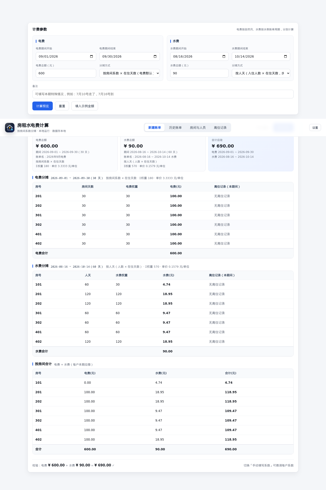 | 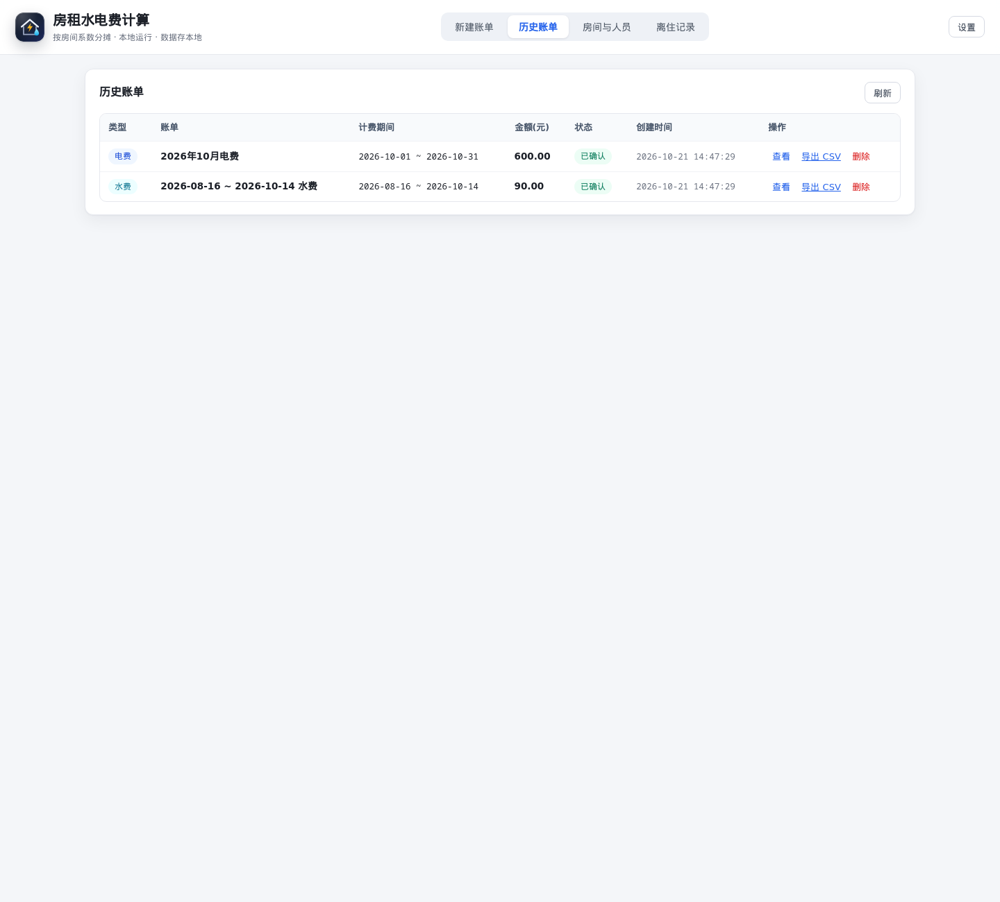 |

| 账单明细（单张费用账单） | 人员离住记录（回老家） |
| --- | --- |
| 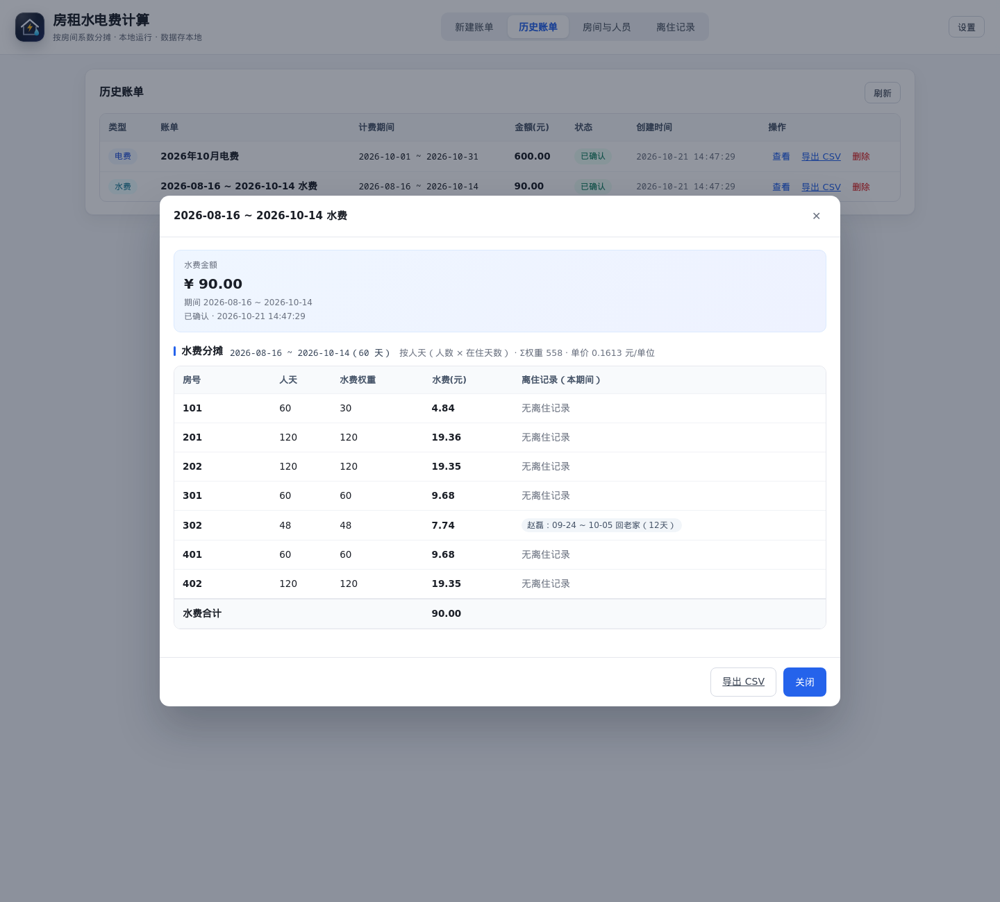 | 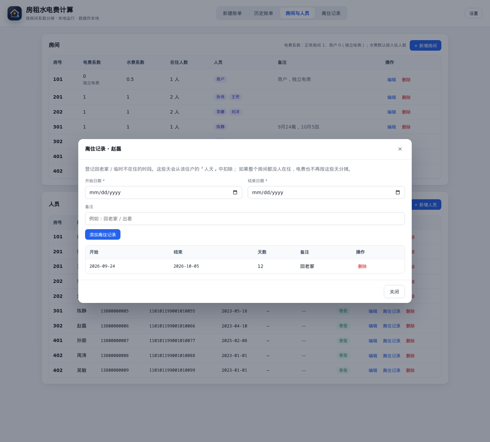 |

| 房间与人员 | 手机端 |
| --- | --- |
| 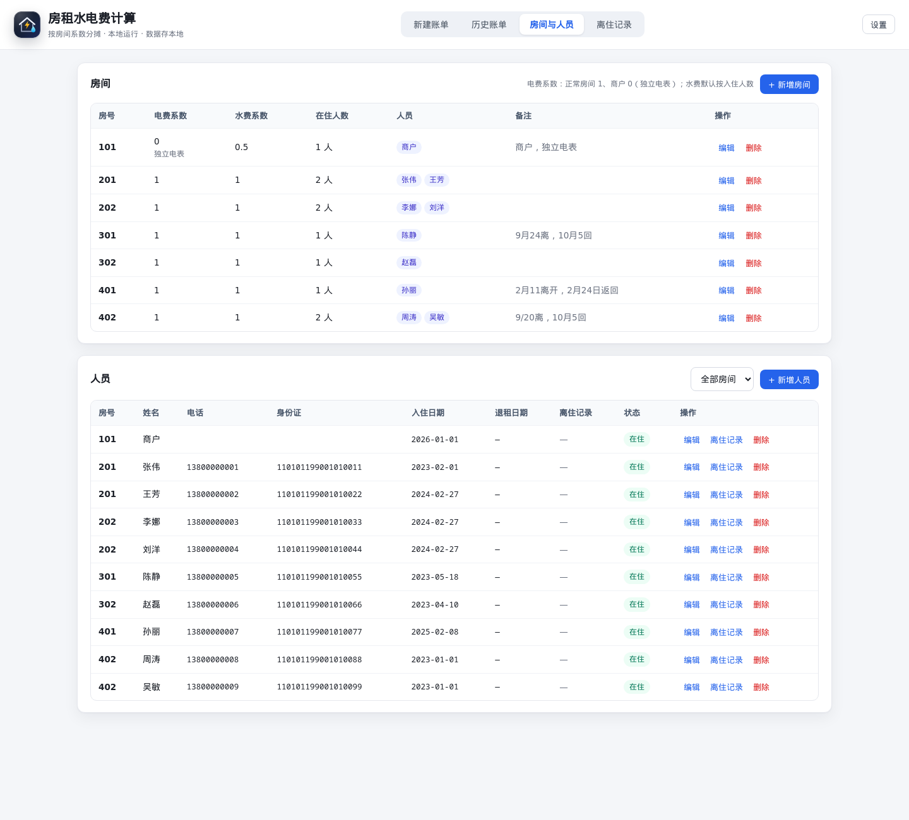 | 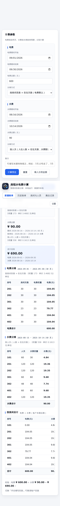 |

| 访问密码 | 离住记录总览（默认最近三个月） |
| --- | --- |
| 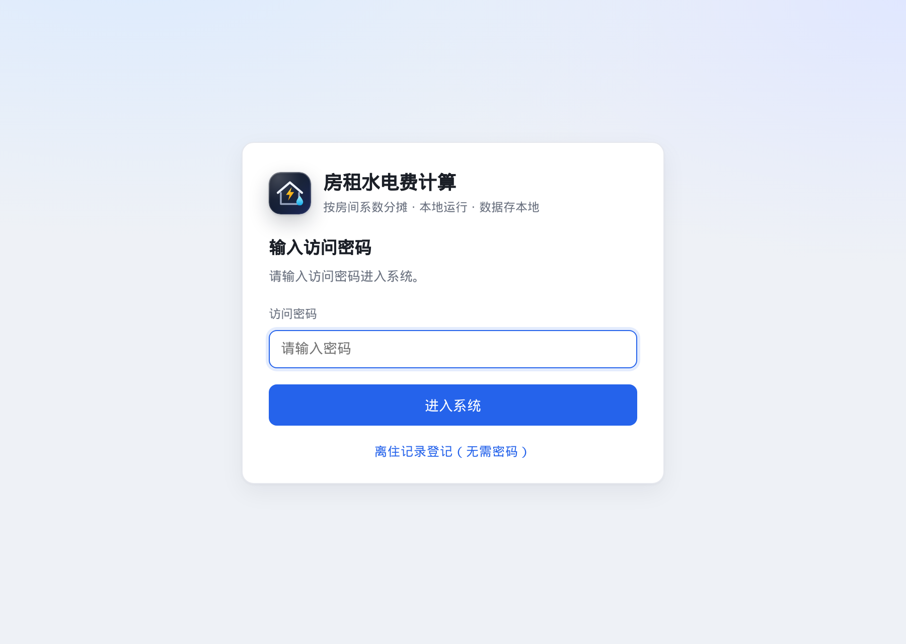 | 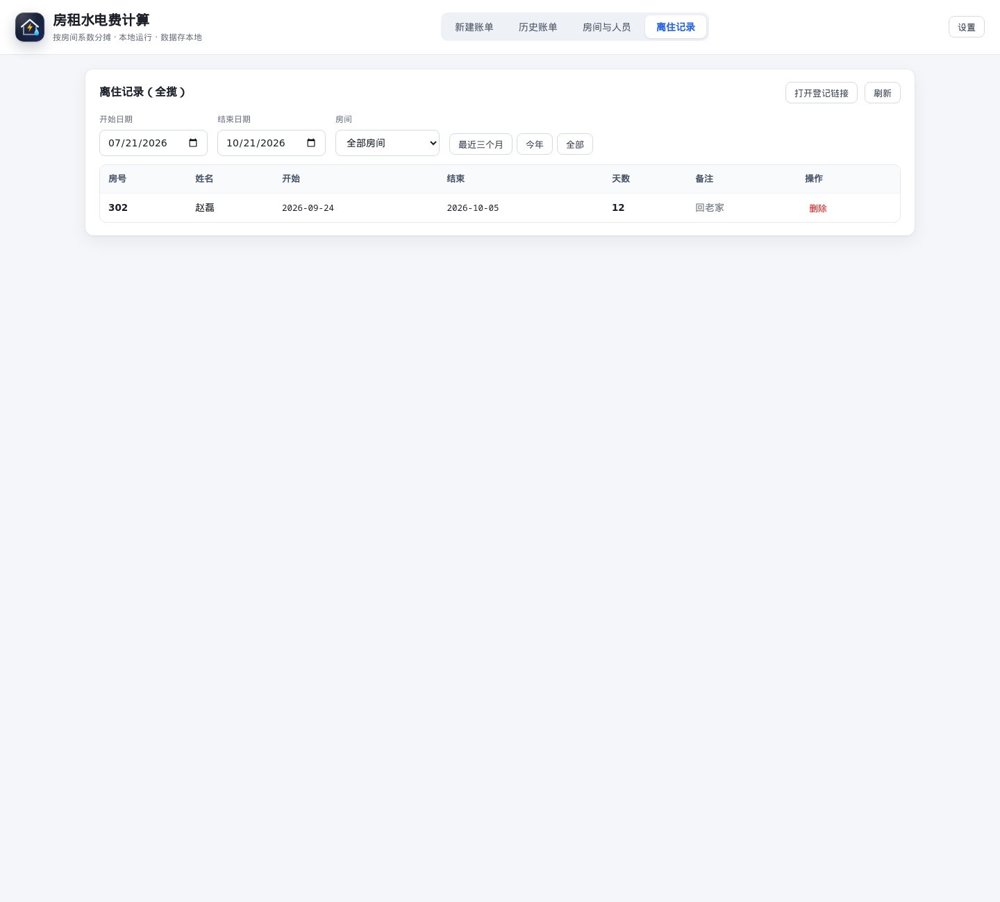 |

| 设置（密码 / 备份恢复 / 登记链接） | 公开页（离住登记 + 近期费用查询，无需密码） |
| --- | --- |
| 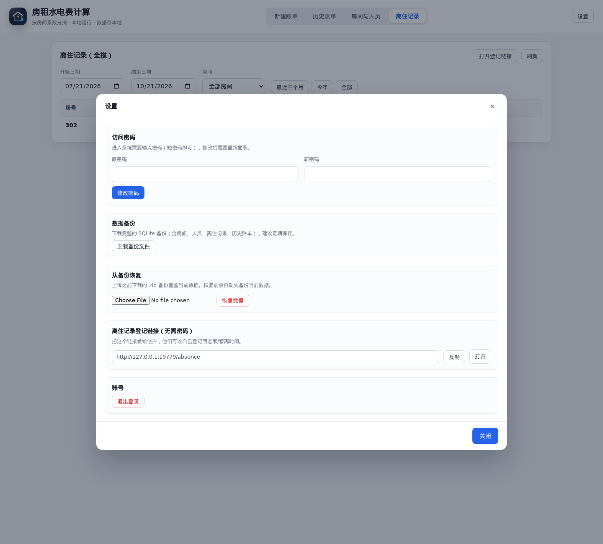 | 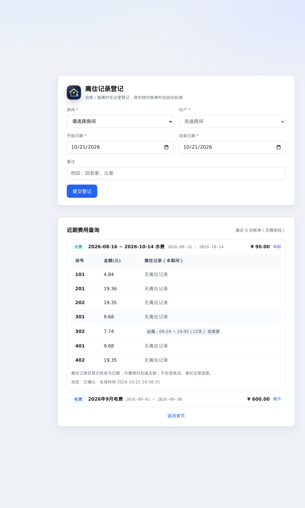 |

---

## 一、与 Excel 表格的对应关系

| 表格位置 | 含义 | 本系统中的位置 |
| --- | --- | --- |
| `E2` = 760.62 | 电费总额 | 新建账单 → 电费总额 |
| `B4:B9` = 30/30/30/24/空/20 | 原表电费系数（实际是「天数 × 人数」） | 新口径：**每个房间电费系数默认 1、商户 0**，权重 = 电费系数 × 在住天数 |
| `B10` = `SUM(B4:B9)` = 134 | Σ系数 | 预览页「Σ权重」 |
| `F2` = `E2/B10` | 单价（元/系数） | 预览页「单价」 |
| `E4` = `B4*$F$2` | 当月电费 | 预览/账单里每间房的电费 |
| `E10` = `SUM(E4:E9)` | 电费合计 | 自动保证与总额分位一致 |
| `E14` = 361.90 | 水费总额 | 新建账单 → 水费总额 |
| `B16:B22` = 59/140/178/59/59/空/118 | 原表水费系数（天数 × 人数） | 新口径：**水费系数默认 1、商户 0.5**，权重 = 水费系数 × 人天 |
| `B23` = `SUM(B22:B16)` = 613 | Σ系数 | 预览页「Σ权重」 |
| `F14` = `E14/B23` | 单价 | 预览页「单价」 |
| `J2:M11` 房号/姓名/电话/身份证 | 人员名册 | 「房间与人员」页 |
| `D4:D9` 入住时间 | 入住日期 | 人员「入住日期」 |
| `C`、`F` 列 | 人数、备注 | 自动统计；备注保留在房间/人员/账单备注 |
| `A13` 的说明「时间：2026-06-15至2026-08-14」「按照每个房间入住人数均分」 | 水费是两个月一期的账单周期 | 水费期间单独录入（默认上上月 16 号 ~ 本月 14 号） |

初始数据（7 个房间、10 位住户，含 101 商户）在首次启动时导入；房间系数按**新口径**初始化：
所有房间电费系数 / 水费系数都是 **1**，`101` 商户电费系数 **0**（独立电表）、水费系数 **0.5**，
需要的话在「房间与人员 → 编辑」里手动改。`npm run reset` 可随时恢复成初始状态。

> 说明：原表 `B` 列系数其实是「天数 × 人数」。现在拆成两个更直观的配置：
> **电费系数** × 房间在住天数、**水费系数** × 人天，结果同样按
> 「单价 = 总额 ÷ Σ权重、房间费用 = 权重 × 单价」分摊。

---

## 二、计算规则

1. **单价** = 该费用总额 ÷ Σ权重
2. **每间房费用** = 该房间权重 × 单价
3. **分位精确闭合**：金额以「分」为单位用最大余数法取整，保证
   `Σ各房间费用 === 费用总额`（不会出现合计差 1 分钱的情况）
4. **房间内再分摊**：房间费用按每位住户在计费期间内的**在住天数**再分一次，
   得到「谁该付多少」，同样分位闭合

### 两种费用各自的计费期间

电费和水费不是同一张账单周期，系统里**分别录入、分别计算**：

| 费用 | 默认期间 | 说明 |
| --- | --- | --- |
| 电费 | 上一个自然月（如 2026-09-01 ~ 2026-09-30） | 按「完整一个月」记账 |
| 水费 | 两月周期：上上月 16 号 ~ 本月 14 号（如 2026-08-16 ~ 2026-10-14） | 按水表账单周期 |

账单名称**自动生成**，规则是「日期 + 电费/水费」：

- 正好一个自然月 → `2026年9月电费`
- 跨月周期 → `2026-08-16 ~ 2026-10-14 水费`

- 「新建账单」里两组日期可以各自修改，互不影响；
- 预览和账单明细里，电费、水费**各自一张分摊表**，最后再给一张「按房间合计」看每户总共交多少；
- 电费、水费分摊表最后一列都直接列出该房间**本期间内的离住记录**（谁、哪天到哪天、几天），
  两种费用按各自的期间裁剪（例如同一次回老家，在 9 月电费里算 7 天、在两个月水费周期里算 12 天）；
- 保存时电费、水费会各生成**一条独立账单**（0 元的不生成），历史列表里一行电费、一行水费，各自查看/导出/删除；
- 每一栏都按自己的期间算占用天数：电费算「房间天数」，水费算「人天」；
- 保存后的账单会同时记录两个期间，列表与 CSV 里都能看到。

### 按天计算（处理回老家 / 空置 / 中途入住）

系统先给每个房间建立一张「按天」的占用日历，再算系数：

- **房间天数**：房间在计费期间内「至少有一位租客在住」的天数；
- **人天**：Σ 每位租客的在住天数；
- **在住天数** = `[入住日期, 退租日期]` ∩ `[计费开始, 计费结束]`，再**扣除「离住记录」**；
  首尾两天都计入；未填入住日期视为期间开始即在住，未填退租日期视为住到期间结束。

| 费用 | 默认分摊方式 | 权重公式 | 说明 |
| --- | --- | --- | --- |
| **电费** | 按房间系数 × 在住天数 | `电费系数 × 房间天数` | 正常房间系数 1，每间每天一份；商户 0 / 空置不计 |
| **水费** | 按人天 | `水费系数 × 人天` | 水费系数默认 1，谁住得多谁多摊；商户手动改 0.5 即减半；回老家期间不计 |

举例（电费期间 30 天、水费期间 60 天；A 房 2 人、B 房 2 人，A 房其中一人回老家 10 天）：

| 房间 | 电费系数 | 房间天数 | 电费权重 | 水费系数 | 水费人天 | 水费权重 |
| --- | --- | --- | --- | --- | --- | --- |
| A | 1 | 30（仍有人在） | 1 × 30 = 30 | 1 | 20 + 30 = 50 | 1 × 50 = 50 |
| B | 1 | 30 | 1 × 30 = 30 | 1 | 30 + 30 = 60 | 1 × 60 = 60 |
| 商户 | 0 | 30 | 0（独立电表） | 0.5 | 30 | 0.5 × 30 = 15 |

> A 房只是少一个人，房间仍算 30 天有人，所以电费不减少；如果 A 房**全员**回老家 10 天，
> 房间天数变成 20，电费按 `1 × 20 = 20` 计算。水费则始终按个人在住天数扣减。
> 商户房（如 101）：电费系数 0 不参与电费，水费固定 0.5 人。

### 特殊房间：商户 / 独立电表

房间资料里有两个专门给商户这类房间用的设置（「房间与人员 → 编辑」）：

| 设置 | 作用 |
| --- | --- |
| **电费系数** | 默认 1；商户填 0（并选「不参与电费分摊」，电费表里不会出现该房间） |
| **水费系数** | 默认 1，参与水费计算；商户手动填 0.5 即按半份分摊 |
| **不参与电费分摊**（独立电表 / 商户） | 电费表里不出现该房间，也不计入电费 Σ权重，不受「系数为 0」提醒 |

表格里的 **101 室** 已按商户配置好：电费系数 0（独立电表）+ 水费系数 0.5。
例如水费期间 63 天时，101 的水费人天 = 63，权重 = 0.5 × 63 = 31.5，按比例分摊水费；电费里完全没有 101。
所有系数都可以在房间编辑里手动调整。

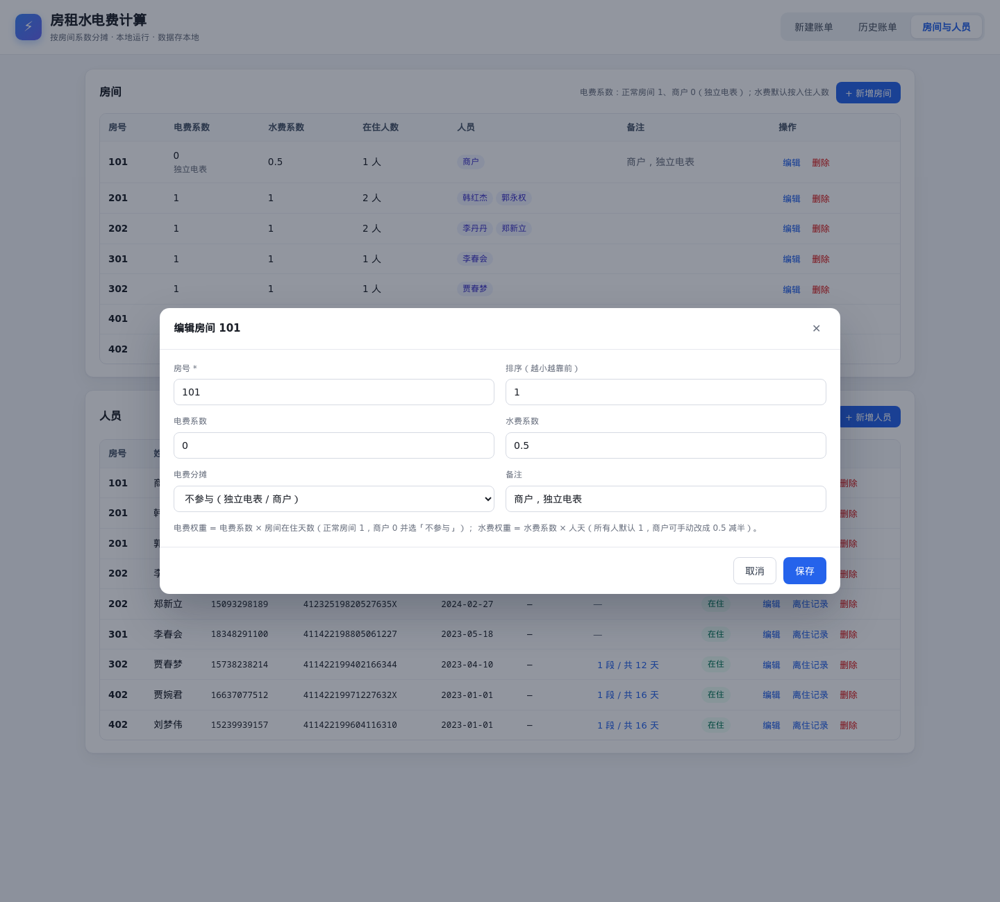

### 四种分摊方式（每项费用可单独选择）

| 方式 | 权重来源 | 适用 |
| --- | --- | --- |
| **按房间系数 × 在住天数**（默认电费） | 电费系数 × 房间天数 | 电费：按房间 + 按时间 |
| **按人天**（默认水费） | 水费系数 × 人天 | 水费：按人数 + 按时间 |
| **按人数** | 水费/电费系数 × 期间内在住人数 | 不按天折算的简单均分 |
| **手动填写系数** | 预览表格里直接改，按该费用口径预填 | 临时微调某户 |

> 「填入示例金额」按钮只是把 760.62 / 361.90 填到总额里方便试算，不会改动分摊方式。

---

## 三、本地运行

要求 Node.js **>= 22.5**（推荐 24，`node:sqlite` 已内置且无需实验开关）。

> 第一次打开 http://localhost:8787 会要求**设置访问密码**（至少 4 位，短密码即可），
> 设置后以后进入系统都要输入；忘记密码见文末常见问题。

### 方式一：后台常驻（推荐，脚本管理）

```bash
./scripts/start.sh     # 启动（脱离终端后台运行，默认 0.0.0.0:8787）
./scripts/status.sh    # 查看进程、健康检查、日志
./scripts/stop.sh      # 停止
```

启动成功会打印访问地址，例如：

```
启动成功（PID 12345）
  本机访问：http://localhost:8787
  局域网访问：http://192.168.1.200:8787
```

- 日志：`data/server.log`（持续追加）
- PID：`data/server.pid`
- 换端口：`PORT=9000 ./scripts/start.sh`
- 只允许本机访问：`HOST=127.0.0.1 ./scripts/start.sh`

### 方式二：前台运行（调试用）

```bash
node app/server.js       # Ctrl+C 停止
```

打开 <http://localhost:8787> 即可（同一局域网用 `http://NAS的IP:8787`）。

### 开机自启（可选）

```bash
./scripts/install-autostart.sh     # 写入用户 crontab：开机启动 + 每 5 分钟存活检查
./scripts/uninstall-autostart.sh   # 取消
```

### 备份 / 维护

```bash
./scripts/backup.sh      # 生成一致性快照到 data/backups/，保留最近 30 份（命令行备份）
npm test                 # 42 个测试：计算逻辑对账 + 接口集成测试（含密码/备份/公开登记）
npm run dev              # 改代码自动重启（node --watch）
npm run reset            # 清空账单并恢复表格初始数据
```

**网页上的备份 / 恢复**：右上角「设置」→ 下载备份文件（`.db`）/ 选择备份文件恢复。
恢复前会自动把当前数据库备份到 `data/backups/pre-restore-*.db`，恢复后数据立即生效。

可选环境变量：

| 变量 | 默认 | 说明 |
| --- | --- | --- |
| `PORT` | `8787` | 监听端口 |
| `HOST` | `0.0.0.0` | 监听地址，只给本机用可设 `127.0.0.1` |
| `DB_PATH` | `./data/billing.db` | 数据库文件位置 |
| `APP_PASSWORD` | 空 | **仅测试/应急**用：未设置网页密码时作为兜底密码（正常请在网页上设置，密码哈希存在 `data/config.json`） |
| `TRUST_PROXY` | 空 | 放在反向代理后面时设为 `1`：用 `X-Forwarded-For` 识别真实 IP（公开登记限流用） |
| `TZ` | 系统时区 | 影响账单「创建时间」 |

```bash
# 应急：忘记密码时，也可以临时用环境变量密码启动
APP_PASSWORD='临时密码' node app/server.js
```

---

## 四、Docker 部署（可选，当前用不上）

> 目前按「本地直接跑」部署，本节仅作备用。镜像构建时不需要 `npm install`（零依赖），所以很快。

```bash
# 方式一：docker compose（推荐）
docker compose up -d --build

# 方式二：手动构建
docker build -t rent-utility-billing:1.0.0 .
docker run -d --name rent-utility-billing \
  -p 8787:8787 \
  -v "$PWD/data:/data" \
  -e TZ=Asia/Shanghai \
  --restart unless-stopped \
  rent-utility-billing:1.0.0
```

- 数据文件在容器的 `/data/billing.db`，compose 已挂载到宿主机 `./data`，**删容器不丢账**
- 容器以 `node` 用户运行；启动脚本会把数据目录属主改成 `node` 后再降权
- 自带 `HEALTHCHECK`，`docker ps` 可看到健康状态
- 需要登录保护：在 `docker-compose.yml` 里取消 `APP_USER` / `APP_PASSWORD` 注释

---

## 五、放在 HTTPS 反向代理后面（可选）

页面本身可以直接挂在 Nginx / Caddy 后面用 HTTPS 访问，无需改代码：

- 自动识别 `X-Forwarded-Proto: https` → 会话 Cookie 自动加 `Secure`，并返回 `Strict-Transport-Security`（HSTS）
- 所有跳转都用相对路径，不写死域名/协议
- 「离住登记链接」按浏览器地址栏生成，HTTPS 访问时会自动是 `https://你的域名/absence`
- 反代时建议让服务只监听本机：`HOST=127.0.0.1 TRUST_PROXY=1`

**Nginx 示例**

```nginx
server {
    listen 443 ssl http2;
    server_name billing.example.com;

    ssl_certificate     /etc/letsencrypt/live/billing.example.com/fullchain.pem;
    ssl_certificate_key /etc/letsencrypt/live/billing.example.com/privkey.pem;

    location / {
        proxy_pass http://127.0.0.1:8787;
        proxy_set_header Host              $host;
        proxy_set_header X-Real-IP         $remote_addr;
        proxy_set_header X-Forwarded-For   $proxy_add_x_forwarded_for;
        proxy_set_header X-Forwarded-Proto $scheme;
    }
}
```

**Caddy 示例**（自动申请证书）

```
billing.example.com {
    reverse_proxy 127.0.0.1:8787
}
```

启动方式：

```bash
HOST=127.0.0.1 TRUST_PROXY=1 ./scripts/start.sh
```

> 注意：如果先用 HTTP 登录过，再切到 HTTPS，浏览器里的旧 Cookie 不能用于 HTTPS，重新登录一次即可。

---

## 六、数据与隐私

- 所有数据只存在本机 `data/billing.db`，不联网、不上传
- 仓库里**不包含**真实租客数据：`data/`（数据库、密码配置、备份、日志）和原始 Excel 表格都已加入 `.gitignore`
- 代码内置的演示数据（房间/人员）为**虚构信息**，首次启动用于体验
- 公开页（`/absence`）只暴露「房号 + 姓名 + 最近 6 份账单的房号/金额」，
  不暴露电话、身份证、历史账单的住户分摊等隐私信息

## 七、目录结构

```
.
├── app/
│   ├── server.js          # HTTP 服务 + 路由 + 认证/备份恢复 + 静态文件 + CSV 导出
│   ├── auth.js            # 访问密码（scrypt 加盐）、会话 Cookie、登出
│   ├── db.js              # SQLite 建表、增删改查、表格初始数据
│   ├── calc.js            # 分摊计算核心（纯函数，可单测）
│   └── public/            # 前端
│       ├── index.html     # 主界面（新建账单 / 历史账单 / 房间与人员 / 离住记录）
│       ├── login.html     # 登录页（首次进入引导设置密码）
│       ├── absence.html   # 公开离住登记页（无需密码）
│       ├── app.js / login.js / absence.js / style.css / favicon.svg
├── test/
│   ├── calc.test.js       # 与表格数字逐项对账的单元测试
│   └── api.test.js        # 真实启动服务的接口集成测试
├── scripts/
│   ├── start.sh           # 后台启动（脱离终端，PID/日志）
│   ├── stop.sh            # 停止
│   ├── status.sh          # 状态 / 健康检查 / 日志
│   ├── backup.sh          # 数据库一致性快照备份
│   ├── install-autostart.sh / uninstall-autostart.sh  # 开机自启
├── tools/ui-smoke.mjs     # 前端冒烟测试（可选，需 npm i -D jsdom）
├── docker/entrypoint.sh   # 容器入口：修权限 + 降权
├── Dockerfile
├── docker-compose.yml
└── data/                  # 运行时生成：billing.db / config.json（密码）/ server.log / server.pid / backups/
```

---

## 八、接口一览

除 `/api/health`、`/api/auth/*`、`/api/public/*` 外，其余接口都需要登录（带会话 Cookie）。

| 方法 | 路径 | 说明 |
| --- | --- | --- |
| GET | `/api/health` | 健康检查（公开） |
| GET | `/api/auth/status` | 是否已设置密码 / 当前是否已登录（公开） |
| POST | `/api/auth/setup` | 首次设置访问密码（公开，仅未设置时可用） |
| POST | `/api/auth/login` | 登录，成功后下发 HttpOnly 会话 Cookie（公开） |
| POST | `/api/auth/logout` | 退出登录（公开） |
| POST | `/api/auth/password` | 修改密码（需登录） |
| GET | `/api/public/rooms` | 公开版房间+住户姓名（仅 id/房号/姓名，无电话身份证） |
| GET | `/api/public/bills` | 公开版最近 6 份账单（仅账单信息 + 房号/房间金额，无住户信息） |
| POST | `/api/public/absences` | 公开登记离住记录（无需登录，限流 30 条/小时/IP） |
| GET | `/api/absences?start=&end=&room_id=` | 离住记录总览（默认前端取最近三个月） |
| GET | `/api/backup` | 下载完整 SQLite 备份（需登录） |
| POST | `/api/restore` | 上传 `.db` 备份恢复（需登录，恢复前自动备份当前库） |
| GET | `/api/meta` | 费用类型、分摊方式、今天日期 |
| GET | `/api/rooms` | 房间列表（含住户） |
| POST/PUT/DELETE | `/api/rooms[/:id]` | 房间增改删（被历史账单引用时改为停用） |
| GET | `/api/tenants` | 人员列表（`?room_id=` 过滤） |
| POST/PUT/DELETE | `/api/tenants[/:id]` | 人员增改删 |
| GET/POST | `/api/tenants/:id/absences` | 离住记录（回老家）查询 / 新增 |
| DELETE | `/api/absences/:id` | 删除离住记录 |
| POST | `/api/bills/preview` | 试算，不落库 |
| GET/POST | `/api/bills` | 账单列表 / 保存账单（电费、水费各一条记录，返回 `{bills:[...]}`） |
| GET/DELETE | `/api/bills/:id` | 账单详情 / 删除 |
| GET | `/api/bills/:id/csv` | 导出单张账单 CSV（UTF-8 BOM，Excel 直接打开） |

试算 / 保存账单的请求体（两种费用各带自己的期间）：

```json
{
  "period_start": "2026-09-01",
  "period_end": "2026-09-30",
  "fees": {
    "electric": { "total": 600, "mode": "room-days", "period_start": "2026-09-01", "period_end": "2026-09-30" },
    "water":    { "total": 90,  "mode": "person-days", "period_start": "2026-08-14", "period_end": "2026-10-15" }
  },
  "overrides": { "electric": { "2": 900 } }
}
```

`period_start/period_end` 是账单主期间（默认取电费期间）；`fees.x.period_*` 省略时回落到主期间。

保存账单时服务端会用同一套公式**重新计算**，不信任前端传来的金额；
若「各房间分配合计 ≠ 费用总额」（例如某项费用所有房间系数都是 0），会直接拒绝保存并提示。

---

## 九、常见问题

**Q：为什么有些房间是 0 元？**
- 商户房（101，独立电表）：电费系数 0，本来就不参与电费；
- 空置房（如 401 没人住）：房间天数 0，电费为 0；
- 若总额不为 0 而所有参与房间的系数都是 0，系统会给出警告并拒绝保存。

**Q：为什么会有 1~2 分钱的差别？**
没有差别。金额按「分」用最大余数法分配，`Σ每间房 === 总额` 是硬约束，测试里也校验了这一点。

**Q：住户回老家几天怎么算？**
在「房间与人员 → 人员」里点该住户的「离住记录」，登记一段回老家时间即可，系统自动从人天里扣除；
电费、水费分摊表最后一列都会显示本期间内每间房的离住记录（跨期间的部分会自动裁剪到本期）。
如果是整间房都空了（比如都回老家 / 退租），电费也不再按这些天分摊。

**Q：水费周期怎么改？**
「新建账单」里水费那一栏有自己的「期间开始 / 期间结束」，直接选日期即可；
默认填**上上月 16 号 ~ 本月 14 号**（本月 15 号之前则截止到上月 14 号）。电费同理，默认上一个自然月。

**Q：账单名称能改吗？**
不用手填，保存时按期间自动生成「日期 + 电费/水费」：
整月是 `2026年9月电费`，跨月周期是 `2026-08-16 ~ 2026-10-14 水费`。

**Q：101 商户为什么电费是 0 元、水费减半？**
101 是商户、独立电表：电费系数 0 且勾选了「不参与电费分摊」，所以电费表里没有 101；
水费系数手动设为 0.5，所以水费权重是「0.5 × 人天」，相当于按半份分摊。
两个系数都可以在房间编辑里随时手动修改。

**Q：想加「房租」或「燃气费」？**
`app/calc.js` 顶部的 `FEE_DEFS` 加一项、`app/db.js` 的建表语句加两列即可（当前按表格只做电费、水费）。

**Q：忘记访问密码怎么办？**
删除 `data/config.json` 后重启服务，再打开网页即可重新设置密码（数据库、账单都不受影响）：
`rm data/config.json && ./scripts/stop.sh && ./scripts/start.sh`。

**Q：离住登记链接安全吗？**
`/absence` 页面不需要密码，只能「新增离住记录」，看不到账单、电话、身份证等任何数据，
并且每个 IP 每小时最多提交 30 条。把链接发给住户或自己手机上填都可以；如果不想公开，
不分享这个链接即可（接口仍然存在，建议只在局域网内使用）。

**Q：数据备份？**
网页「设置 → 下载备份文件」可随时下载完整 `.db`；也可以停服务后复制 `data/` 目录，
或运行 `./scripts/backup.sh`（保留最近 30 份）。恢复用「设置 → 从备份恢复」，上传 `.db` 即可。
